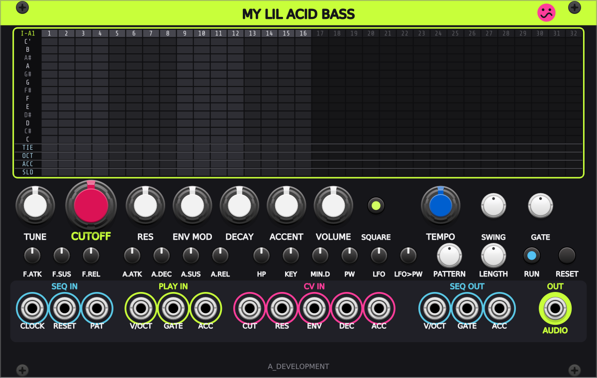
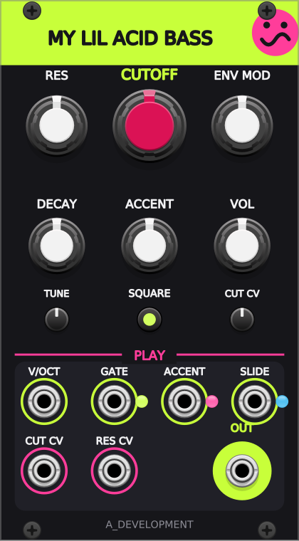

# My lil Acid Bass for VCV Rack

**by A_Development**

The acid bass voice and 32-step acid sequencer from [My lil acid bassline](https://adev-io.github.io/my-lil-acid-bassline/)
as VCV Rack 2 modules. Same voice and the same sequencing rules as the web app and the FL Studio VST3, so a pattern
sounds the same in all three. The FL Studio build lives in its own repo and is not touched by this one.

 

**The panels.** Lime means play it (V/OCT, GATE, ACC, SLIDE), magenta means modulate it (the CV inputs), blue is the
sequencer (CLOCK, RESET, PAT and the SEQ outputs), and the audio output sits on a lime pad. The big red knob is CUTOFF;
the halo behind it breathes with the filter envelope, so the sweep you hear is the sweep you see. SQUARE and RUN are
lit buttons. Hover anything for its value in Hz, seconds or percent.

## Acid Bass (40 HP)

**Step grid.** 32 steps. Click a pitch cell to place a note (click it again to remove it). Lanes under the keys:
**TIE** holds the previous note, **OCT** cycles up / down / normal, **ACC** accent, **SLD** slide into the next note.
Set the pattern length (1-32 steps) with the LENGTH knob, or click a step number in the top row; the knob follows
whichever pattern is playing. The lit column is the step playing.

**Voice.** Tune, Cutoff, Res, Env Mod, Decay, Accent, Volume, Square. Second row: filter attack / sustain / release,
amp attack / decay / sustain / release, HP (input high-pass), Key follow, Min decay, Pulse width, LFO rate, LFO to PW.

**Sequencer.** Tempo (40-300 BPM, used when CLOCK is not patched), Swing, Gate length (55 % at noon),
Pattern (32 slots, I-A1 to II-B8), Length (steps in the playing pattern), Run, Reset.

**Inputs.**
- SEQ IN: CLOCK (one pulse per 16th; replaces the Tempo knob), RESET, PAT (0-10 V picks a slot, added to the knob).
- PLAY IN: V/OCT, GATE, ACC. Play the voice from another sequencer or a keyboard. A pitch change while the gate is high
  slides (portamento). ACC high at the start of a note accents it. The voice is mono and shared with the built-in
  sequencer: play one or the other (an empty pattern or Run off leaves the voice to the PLAY inputs).
- CV IN: CUT (1 V/oct), RES, ENV, DEC, ACC (10 V moves the knob through its whole range).

**Outputs.** SEQ OUT V/OCT, GATE, ACC (drive any other voice with the acid line; the gate stays high through slides and
ties), ENV OUT FILT and AMP (the filter and amp envelopes, 0-10 V, accent included), and AUDIO (±5 V).

**Right-click menu.** Copy the pattern as step notation or as JSON, paste either one back (also the web app's exported
`.txt` files), clear the pattern, and **Load demo set**: the web app's six starter lines in I-A1 to I-A6, with their sound.

Step notation, one token per step: `C`..`B` note, `C'` high C, `^` `_` octave up / down, `*` accent, `~` slide,
`-` rest, `=` tie. Example: `A* - A A^ - A_* A - G~ A - A* - C^ - E~`.

Patterns are saved with the patch. Edit → Undo / Redo (Ctrl+Z / Ctrl+Shift+Z) covers grid clicks, paste, clear and
Load demo set as well as the knobs. **Initialize** (right-click → Initialize, Ctrl+I) resets the knobs **and clears all
32 patterns**; Undo brings them back.

## Acid Voice (14 HP)

The same voice on its own, for sequencing from any other module. Cutoff, Res, Env Mod, Decay, Accent, Vol, Tune,
Square; the Tweaks and envelope extras stay at the web app's defaults.

- **V/OCT**, **GATE**, **ACCENT** (high when the gate rises: louder, brighter, shorter decay; stacked accents build up
  the sweep), **SLIDE** (high when the gate rises: glide in from the last note without retriggering the envelopes).
  A pitch change while the gate is high also slides, so tied-gate sequencers work without the SLIDE jack.
  The lights beside GATE, ACCENT and SLIDE show what the voice is doing right now.
- **CUT CV** (scaled by the CUT CV trimpot, 100 % = 1 V/oct) and **RES CV** (10 V = full range).
- **OUT**, ±5 V audio, soft-clipped like the original output stage.

## Build

Needs MSYS2 (mingw64) and the Rack 2 SDK.

```sh
export RACK_DIR=/c/dev/Rack-SDK
make test      # core checks: voice, sequencer, clock, notation (against the FL plugin's own reference numbers)
make install   # builds and copies the plugin into Rack's plugins folder
make dist      # builds the .vcvplugin package into dist/
```

`core/` holds the DSP and sequencer with no Rack code in it; `src/` is the Rack modules. The panels and the component
positions come from one table per module: `py -3.11 tools/panel.py` rewrites `res/*.svg` and `src/layout.hpp` (needs
`fontTools`; the labels are paths set in the DejaVu Sans that ships with Rack). `tools/rig/` is Windows-only dev
tooling for hands-on checks in an isolated Rack; it is not part of the plugin package.

## License

MIT. See [LICENSE](LICENSE).
